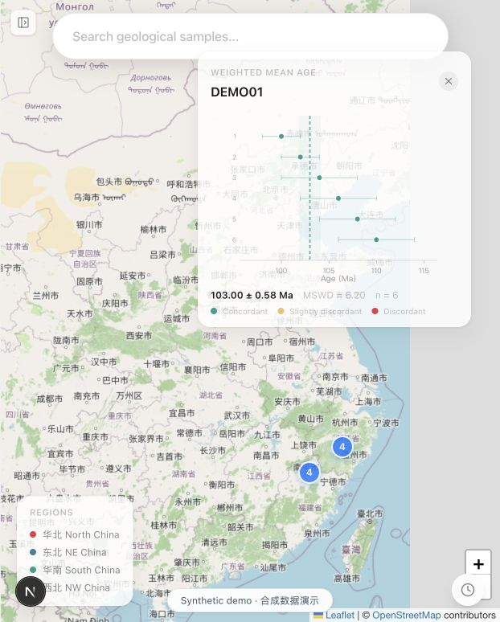
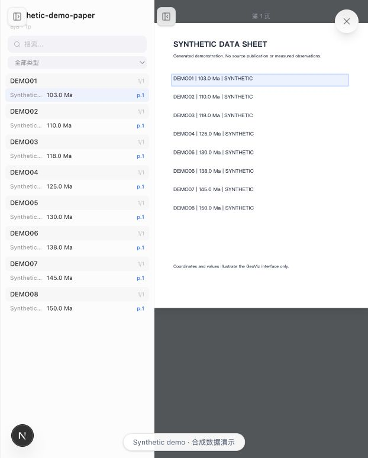

# GeoViz · 地质年代数据探索与原文溯源


[English](README.md) · **简体中文**

面向文献来源地质年代数据的研究平台，通过 **地图 → 样品 → 测点 → 年龄计算 → 原文页面** 串联数据探索。项目包括 Next.js／React 界面、FastAPI 服务、地质年代计算工具和多条检索实验路径。这个独立展示版本使用 **8 个合成样品、48 条合成测点**，不附带私人研究数据和论文。

## 🔬 研究目的

抽取出的地质记录需要进一步支持位置与地层背景检查、样品比较、底层测量查看和字段证据回溯，才能进入实际科研流程。GeoViz 实现了文献抽取与后续科学分析之间的交互层，重点是让研究者能够检查数据和证据，并据此开展分析。

## 🗺️ 已实现的工作流程

|界面／能力|实际实现|代码证据|
|---|---|---|
|地图与样品浏览|Leaflet 点位与聚合，按参考文献和样品号前缀组织记录，最多同时比较四条记录|[主页面](frontend/src/app/page.tsx)、[地图](frontend/src/components/MapView.tsx)、[侧栏](frontend/src/components/Sidebar.tsx)|
|测量数据探索|测点表格、纳入／排除状态编辑，以及前端年龄计算|[SpotTable](frontend/src/components/SpotTable.tsx)、[useSpots](frontend/src/hooks/useSpots.ts)、[计算函数](frontend/src/utils/spotCalc.ts)|
|年龄与地层视图|逆方差加权平均年龄和 MSWD、KDE 峰值、最小表观年龄、Wetherill 谐和图、时间轴与内置地层参考视图|[方法说明](docs/methods.md)|
|原文溯源|字段列表、来源页面、翻页与归一化 bounding box 高亮|[ProvenanceViewer](frontend/src/components/ProvenanceViewer.tsx)、[溯源方法](docs/methods.md)|
|自然语言访问|研究模式默认 v3：解析查询、确定性元数据筛选、基于命中记录组织回答|[rag_v3.py](backend/rag_v3.py)|
|检索探索|v2 结构化／向量／知识图谱混合检索；独立的社区报告 GraphRAG 适配器|[检索路径说明](docs/architecture.md)|

<p>


</p>

以上是本地实际运行截图，使用合成输入展示年龄计算与来源字段定位。

## ⚙️ 运行合成数据展示

需要 **Python 3.12、Node 24+、uv 和 npm**。在仓库根目录执行：

```bash
uv sync --locked
uv run --locked uvicorn --app-dir backend main:app --host 127.0.0.1 --port 8000
```

另开终端，在同一根目录执行：

```bash
npm --prefix frontend ci --ignore-scripts --no-audit --no-fund
npm --prefix frontend run dev -- --hostname 127.0.0.1
```

打开 `http://localhost:3000`，选择 `DEMO01`，查看 **Wtd. Mean、Concordia、Spots、Strat、View in Source**，也可以打开时间轴。搜索 `凝灰岩`、`DEMO01` 或 `全部`，体验明确标注的**本地关键词演示**。演示模式不调用模型，且关闭可触发模型／索引操作的可选接口；新增离线搜索不作为原有 LLM 检索算法展示。

来源页面是生成的 SVG 数据表，不是已发表论文。为兼容原导入关系保留了 `realSamples.json`、`realSpots.json` 文件名，但本仓库中的内容全部为合成数据。详见[数据格式](docs/data.md)和[运行说明](docs/running.md)。

## 🧪 实际材料与验证

原始本地前端快照有 **437 条归一化样品记录、330 个不同样品号字符串、1,209 条测点记录和 23 个参考来源标签**；其中 **1,048 条测点**的样品号出现在该样品快照中。重名样品与未匹配记录仍需核对，不能直接把这组文件当成已经清洗好的关联数据库。这些数量是文件清点结果，不是抽取准确率。[统计与来源哈希](evidence/original_artifact_inventory.json)。

外部 GraphRAG 材料包含 479 个节点、1,174 条边和 18 份社区报告，本展示仓库不附带这些材料。研究模式默认 `/api/chat` 使用的是 v3 结构筛选。本项目尚未提供检索质量提升的受控测评，也不把系统回答作为独立验证的地质发现。

本地检查及保留的 lint 问题记录在[验证说明](docs/validation.md)。可运行：

```bash
uv run --locked python -B scripts/check_backend.py
node scripts/check_science.mjs
npm --prefix frontend run build
npm --prefix frontend run typecheck
uv run --locked python -B scripts/check_repository.py
```

## 🧠 科学计算与 AI 方法

年代工具实现的是已有公式和描述性方法；谐和图用于可视化，没有实现带误差协方差的谐和年龄拟合。溯源脚本通过文本归一化、关键词、n-gram 与 LCS 对齐定位原文及页面范围；文本匹配成功可以支持回溯查看，不等于验证了该条记录的科学正确性。

AI 相关工作体现在专业数据、明确检索路径、来源上下文与交互分析的整合。v3、v2 和 GraphRAG 的职责在[架构说明](docs/architecture.md)中分别解释，按实现与研究探索描述，不包装成新基础模型或已经验证有效的新检索算法。

## 🗂️ 目录结构

```text
frontend/       保留的 Next.js 界面、科学计算工具及合成输入
backend/        FastAPI、数据加载、检索实现与共享客户端
scripts/        原转换／溯源脚本，以及新增演示与本地检查
data/demo/      合成 pipeline 格式记录与生成的来源页面
docs/           方法、架构、数据、运行、验证和来源说明
evidence/       小型脱敏清点与验证记录
provenance/     原始来源哈希与明确的适配说明
```

## 🔌 接入研究环境

使用私人研究数据时，需要显式设置 pipeline 输出、论文清单和溯源目录，并用获得授权的归一化数据重新构建前端；随后关闭 `GEOVIZ_DEMO_MODE`，通过环境变量提供选定服务的凭据。向量／GraphRAG 可选依赖使用 `uv sync --locked --extra retrieval`，图、社区、报告文件和凭据仍需另外提供，构建索引可能调用收费 embedding 服务。具体步骤见[运行说明](docs/running.md)。

本次整理没有调用模型 API；复制模块中的硬编码凭据默认值已移除。缓存、向量索引、私人文档和原始研究数据不进入候选发布集合。

## 📚 来源与复用

这是保留原项目不动的本地审阅快照。[来源清单](provenance/source_manifest.json)区分字节一致的研究文件，以及凭据／路径、演示启动和少量呈现适配。数值计算与原文匹配算法保持原实现；合成输入、离线关键词搜索、检查脚本和文档属于本次展示整理新增内容。

前端 Git 历史只有 Create Next App 初始提交，实际应用修改主要保存在尚未提交的本地文件中，不能据此推断详细个人贡献。公开前需要确认作者与协作者署名、复用代码权属、数据使用权限和最终许可证。[来源说明](docs/provenance.md) · [第三方说明](THIRD_PARTY_NOTICES.md)。
