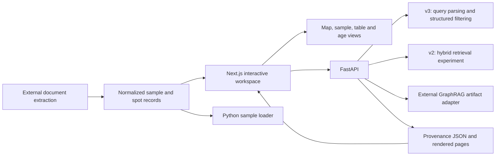

# System architecture and retrieval boundaries

[English overview](../README.md) · [中文概览](../README.zh-CN.md) · [Methods](methods.md) · [Data](data.md)

## A scientific exploration layer

Extraction and autonomous scientific research are adjacent projects. GeoViz consumes normalized outputs and provides a human-facing exploration/provenance workflow. It does not run the full extraction pipeline or automatically execute the separate DeepResearcher organization from its frontend.

## Current frontend data flow

[`page.tsx`](../frontend/src/app/page.tsx) connects the sidebar, selected sample IDs, map, comparison, timeline and right-hand analysis views. The current sample list is statically imported by [`samples.ts`](../frontend/src/data/samples.ts) from `realSamples.json`. [`useSpots`](../frontend/src/hooks/useSpots.ts) imports `realSpots.json`, groups by `sample_id` and derives displayed grain counts. The table edits in-memory React state, so excluded spots affect the active client session. They are not automatically persisted to a research database.

The frontend does not populate its main map by fetching `/api/samples`. Updating the backend alone therefore does not update the statically bundled map. Research-data replacement needs an authorized frontend input export and a rebuild. The shared legacy filenames contain synthetic data in this showcase.

Provenance is fetched dynamically through `useProvenance`: list available papers, load a paper's field records, then serve its page images. The viewer uses `bbox_norm` and displayed image dimensions to draw the selected field's highlight. The built-in sample-to-paper selection uses reference-name matching and substring fallback, which should be reconciled with stable publication identifiers for research use.

## Three distinct research retrieval paths

|Path|Actual behavior|Dependencies and evidence boundary|
|---|---|---|
|**v3: default research `/api/chat`**|LLM parses intent and metadata filters; Python filters the loaded sample list; oldest/youngest/count/statistics have explicit behavior; an LLM formats up to 15 sample summaries, with selected aggregates for statistics.|`rag_v3.py`, MiMo-compatible shared client and normalized records. It is structured retrieval, not vector search.|
|**v2: hybrid experiment**|An LLM chooses semantic, graph-navigation, graph-relation, structured or hybrid intent. Chroma vector results, NetworkX traversal and/or filters contribute matches, deduplicated by sample ID; graph context enriches answer input.|`rag_v2.py`, `vector_store.py`, `knowledge_graph.py`, Gemini-compatible client/embedding calls and a local vector store. First use may build an index.|
|**GraphRAG adapter**|Loads externally built graph, community membership and community reports; ranks reports using embedding cosine and keyword scores; answers from selected community summaries. Local search inspects sample neighbors and community peers.|`graphrag_engine.py`, external graph/report files, model SDKs and credentials. This repository retains the consumer, not the full graph/report builder.|

These paths have separate schemas, data assumptions and endpoints. A `RAG` module name does not establish comparative retrieval performance. The default research path is v3, and the default **showcase** path is the explicitly added offline demo.

## Knowledge graph construction

The local `KnowledgeGraph` constructs a NetworkX `MultiDiGraph`. Node types include samples, formations, groups, basins, regions/provinces, rock types, dating systems, techniques, minerals, age types, locations and references. Edges represent hierarchy, attributes, citations, temporal proximity and shared formations. Temporal proximity is a rule-based age-distance relation; it is not a learned geologic correlation.

Sample nodes and indices depend on `sampleId`, so repeated identifiers across papers can collapse or overwrite identity unless reconciled beforehand. This matters because the original normalized sample snapshot contains more records than unique sample-ID strings. See [data inventory](data.md).

## Showcase adaptations

`showcase_support.py` adds lazy loading so importing the default API does not require the optional vector stack. With `GEOVIZ_DEMO_MODE=1` (the default), `/api/chat` uses a simple, labeled keyword demonstration, while optional model/index routes return 503. Research mode selects the preserved v3 code. The demo startup configures bundled synthetic pipeline/provenance inputs. Original numerical and text-matching algorithms are preserved.

Frontend adaptations are limited to configurable API/tile addresses, visible map attribution, escaping response HTML before the existing limited markdown formatting, and a visible synthetic-data label. They do not redesign the interface or change scientific calculations.
